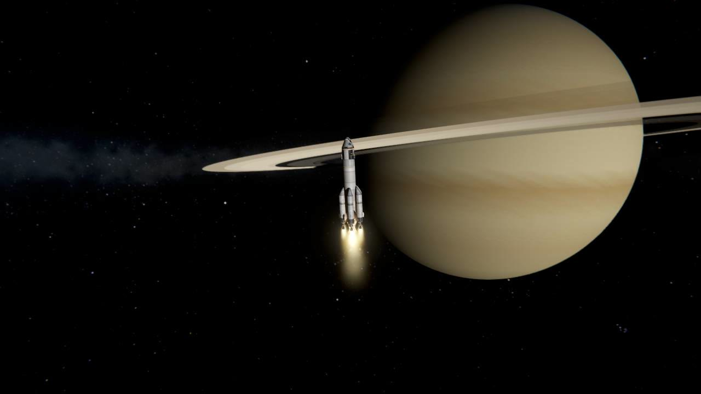
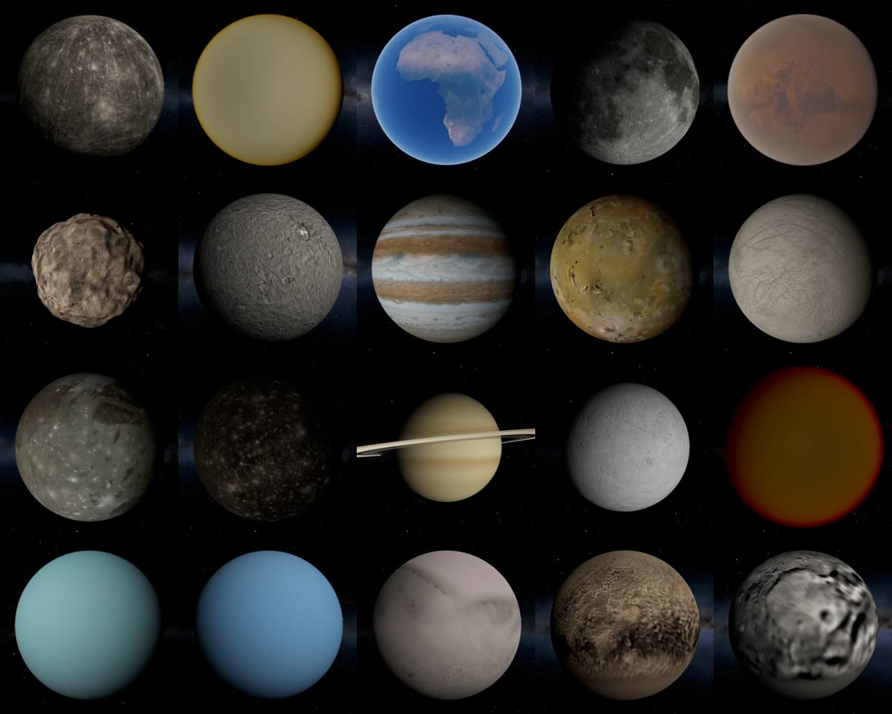
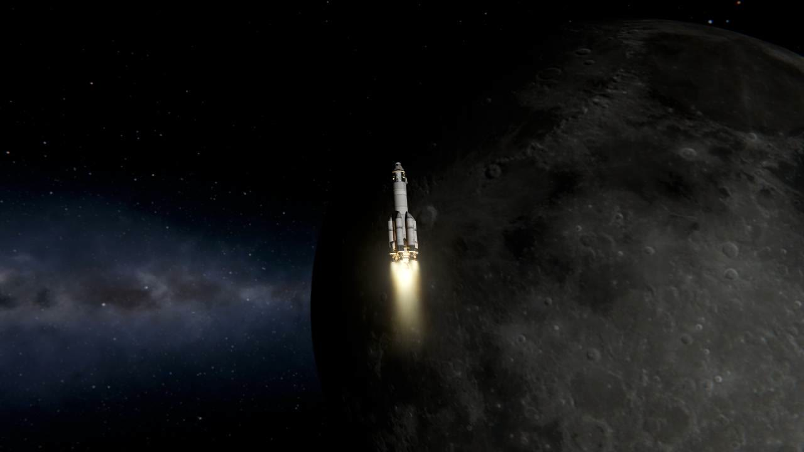

# Real Worlds

The real Solar System at its real size, from NASA's and JPL's figures and maps.

For Kerbal Space Program 1.12.x. **Needs [Keystone](https://github.com/IshiakiZ/ksp-keystone)** ([on SpaceDock](https://spacedock.info/mod/4665/Keystone)),
**[Kopernicus](https://github.com/Kopernicus/Kopernicus)** with what it needs (ModularFlightIntegrator, KSPTextureLoader,
Harmony), all separate downloads.

**It replaces every world. Start a new save for it:** craft in a save made without it were made for Kerbin's worlds and
may be lost (if you load one, Real Worlds keeps a copy of it as it was, and says where).

## What is in it

* **22 worlds** at their measured sizes, masses, spins and orbits (JPL's, at noon on 1 January 2000): the Sun, the
  eight planets, and the largest moons and dwarf planets. The stock worlds become them (Kerbin is Earth, the Mun the
  Moon); Saturn, Uranus, Neptune, Triton and Charon are new. Saturn has its rings.
* **Their ground from spacecraft maps:** heights and colours from NASA, NOAA and the USGS (Earth, the Moon, Mars,
  Mercury, Venus and the moons), the space centre at Cape Canaveral's launch complex 39A.
* **Their air from measured profiles:** pressure and temperature with height for Earth, Venus, Mars, Titan and the
  giants; Scatterer's skies set for them where it is installed.
* **Biomes from the maps:** Earth's oceans, shores, deserts, forests and ice; the Moon's maria by name (Apollo 11 lands
  in Mare Tranquillitatis); Mars's caps, Olympus Mons, Valles Marineris; named regions on the rest.
* **Real dates and faster warp:** the clock shows the real date in UTC, days of 24 hours and years of 365 days; time
  warp to 10,000,000 times. Both can be switched off on its Keystone page.

Making History's launch sites are taken out (on Earth some lay under the Pacific).

## Install

Copy the `RealWorlds` folder from the download into your KSP's `GameData`, beside `Keystone`, `Kopernicus`,
`ModularFlightIntegrator`, `KSPTextureLoader` and `000_Harmony`.

## Use

Start a new save. Reaching low Earth orbit takes about 9.4 km/s: the stock rockets were made for Kerbin, so a rocket
for Earth is far larger (or comes from a parts mod). The Keystone window (the keystone button, or Alt-K; Option-K on a
Mac) has its switches and today's date in the game.

## Works on

Mac: tried. Windows 11: the same configs and code, not run there. Linux: never run.

## Licence

[CC BY 4.0](LICENSE): use it, change it and pass it on as you like, as long as you credit Ishiaki and link back
here. The maps it is made from are NASA's, NOAA's and the USGS's, free to use with credit; each is credited on the wiki.
